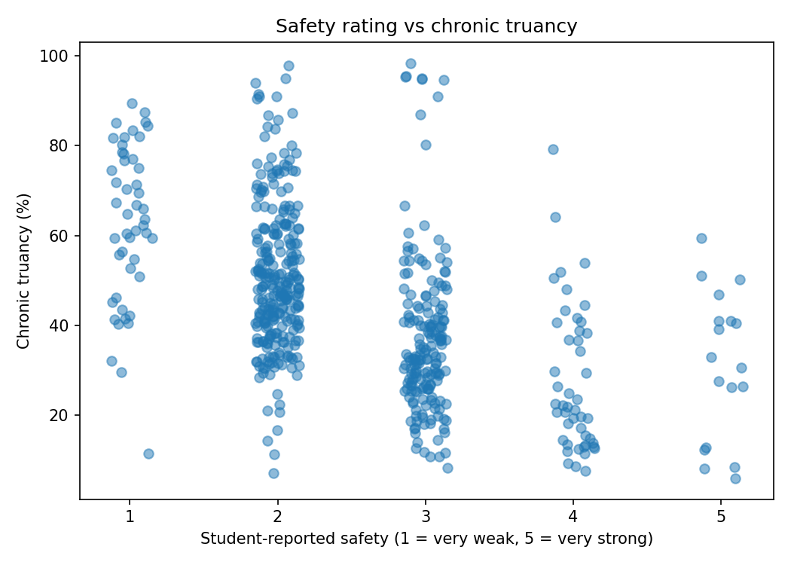
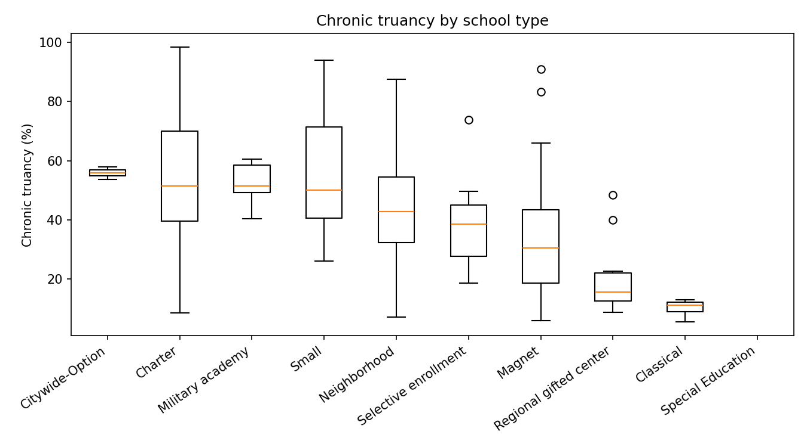
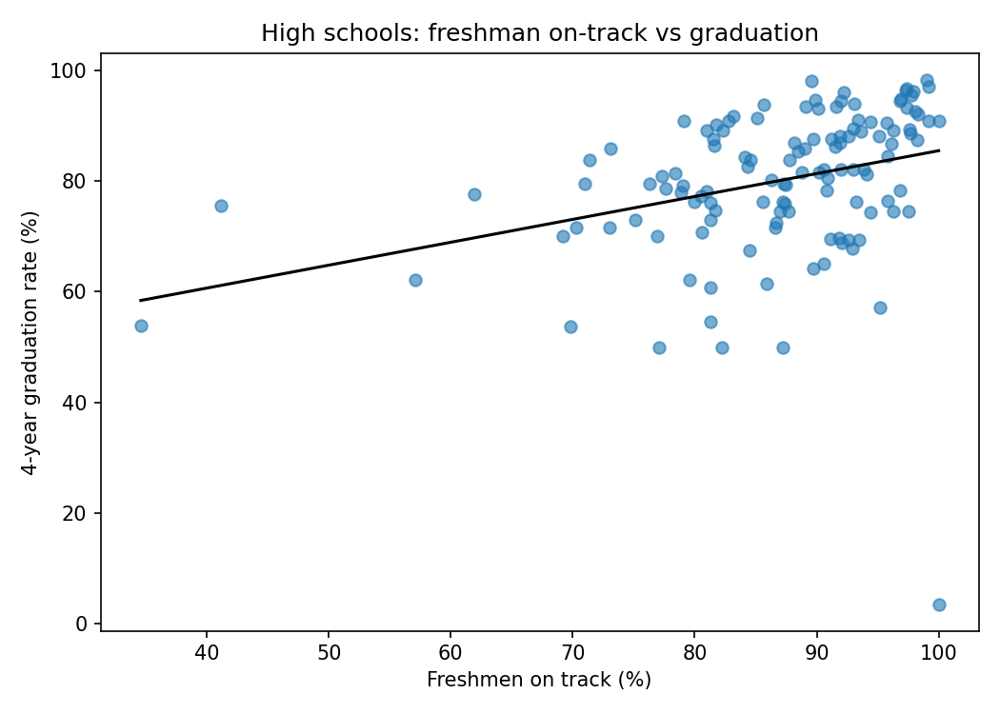

# CPS School Climate & Attendance Analysis

An analysis of how chronic truancy relates to school climate, safety ratings, and student mobility across Chicago Public Schools, with a plain-language training guide for non-technical audiences.

**Data:** Chicago Public Schools School Progress Reports, from the Chicago Data Portal (dataset `2dn2-x66j`). Public, school-level data with no student records.
Landing page: https://data.cityofchicago.org/d/2dn2-x66j

## Key findings

After cleaning, the analysis covers **648 schools** (2 schools with no progress report were removed).

- **Truancy differs a lot by school level and type.** Median chronic truancy is 66.5% for high schools (n=169) vs 40.1% for elementary schools (n=471). By school type, medians range from 11.2% (Classical, n=6) to 55.9% (Citywide-Option, n=19).
- **Safety ratings are the survey measure most strongly linked to truancy.** Student-reported safety has a Spearman correlation of -0.54 with chronic truancy. The overall climate rating is weaker (-0.24).
- **Mobility and suspensions move with truancy.** Mobility rate (0.64) and suspensions per 100 students (0.61) are both positively correlated with chronic truancy.
- **Regression:** in an OLS model (n=545, robust standard errors) with safety, climate, mobility, and school level, R-squared is 0.64. Holding the other variables constant, each 1-point higher safety score is associated with about 5.9 percentage points lower chronic truancy, and each additional percentage point of mobility with about 0.6 points higher. Full output is in `outputs/regression_summary.txt`.
- **High schools:** freshmen on-track and 4-year graduation rate are positively but modestly correlated (r = 0.33, n=125, p = 0.0002).





## What these results do not show

- **These are associations, not causes.** The data can't say whether safety affects attendance, attendance affects survey responses, or something else drives both.
- **Everything is at the school level.** Results don't describe any individual student.
- **Chronic truancy and student attendance are nearly the same measure** (Spearman -0.98), so that relationship isn't an independent finding.
- **Missing data is substantial.** 493 of 648 schools report an SAT average of 0, which I treated as missing. The regression uses 545 of 648 schools because of missing survey ratings. Special Education schools have no truancy values in this dataset, so they are blank in the school type table.
- **Small groups are noisy.** Some school types have only 6 to 11 schools.
- **School types aren't comparable by design.** Selective, magnet, and classical schools admit students differently, so gaps between types shouldn't be read as the effect of the school type.
- **Check the data year before citing it.** The file's year columns show 2021 and 2022, while the portal labels the dataset SY2324. Confirm which applies before quoting a school year.

## What's here

| File | Purpose |
|---|---|
| `analysis.py` | Python (pandas, SciPy, statsmodels): cleaning, data quality log, correlations, regression, charts |
| `analysis.sas` | The same analysis in SAS. **Not yet run.** |
| `training_guide.md` | 30-minute workshop plan, handout, and feedback survey for non-technical staff |
| `outputs/` | Cleaned data, data quality log, correlation table, regression output, charts, and summary |
| `requirements.txt` | Python packages |

## Run it

```
pip install -r requirements.txt
python analysis.py
```

Results and charts are written to `outputs/`. If the download fails, save the CSV from the landing page and run `python analysis.py yourfile.csv`. It also runs in Google Colab.
